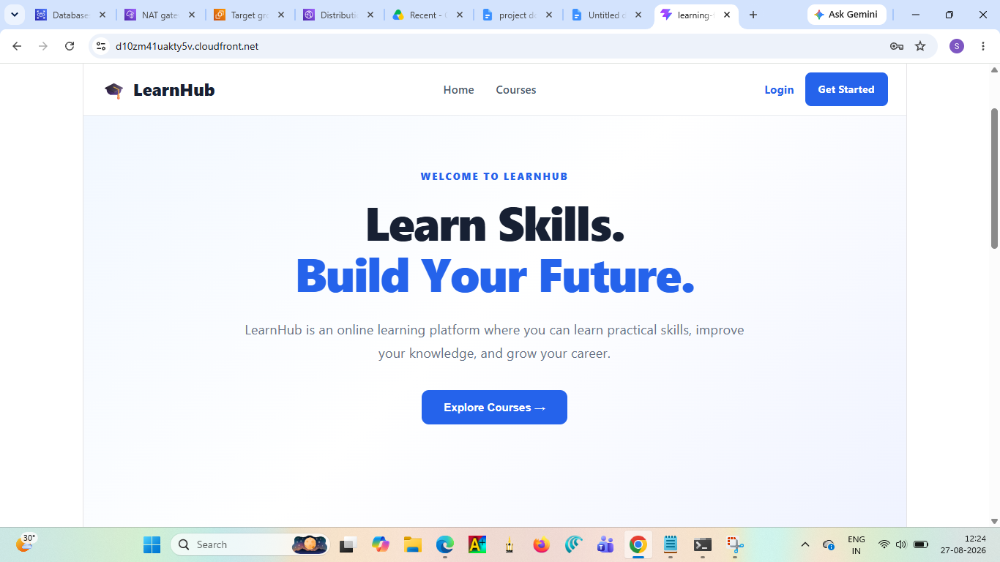
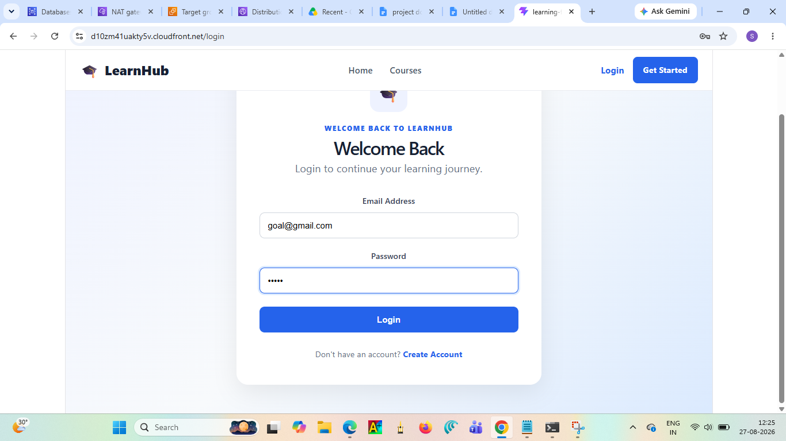
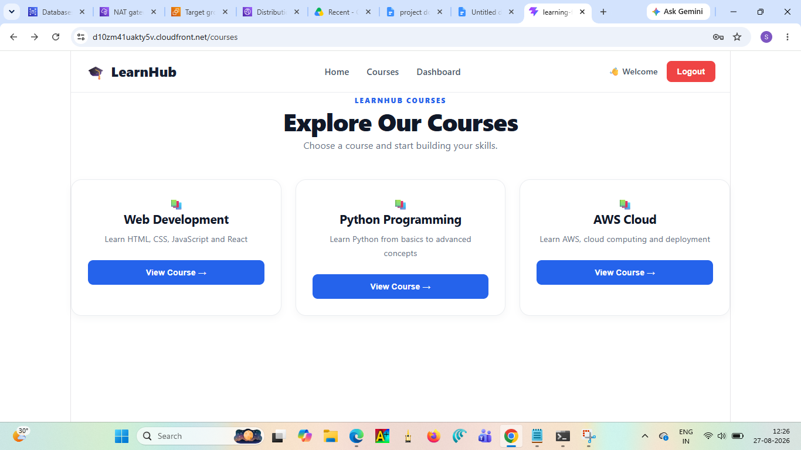
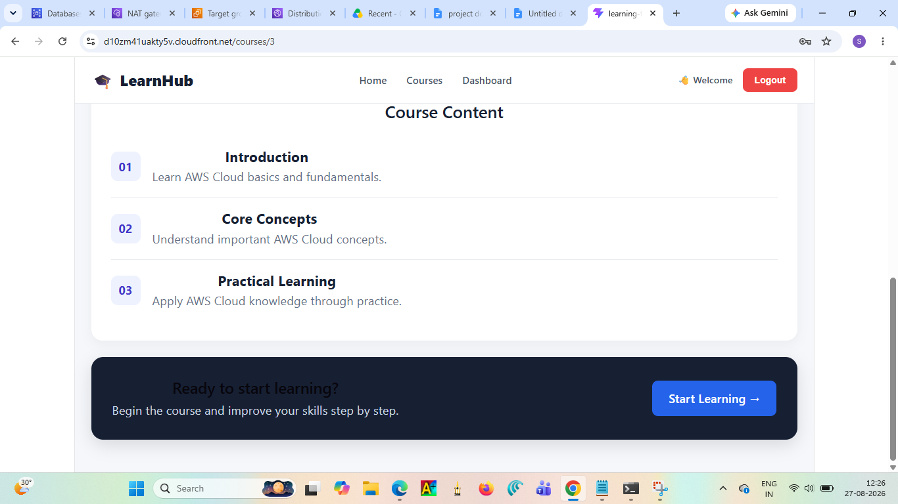
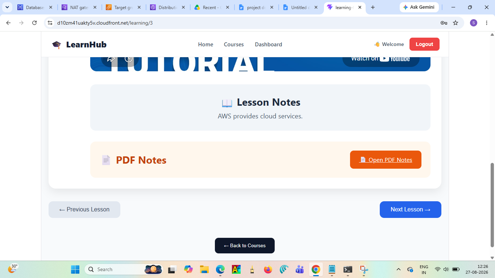
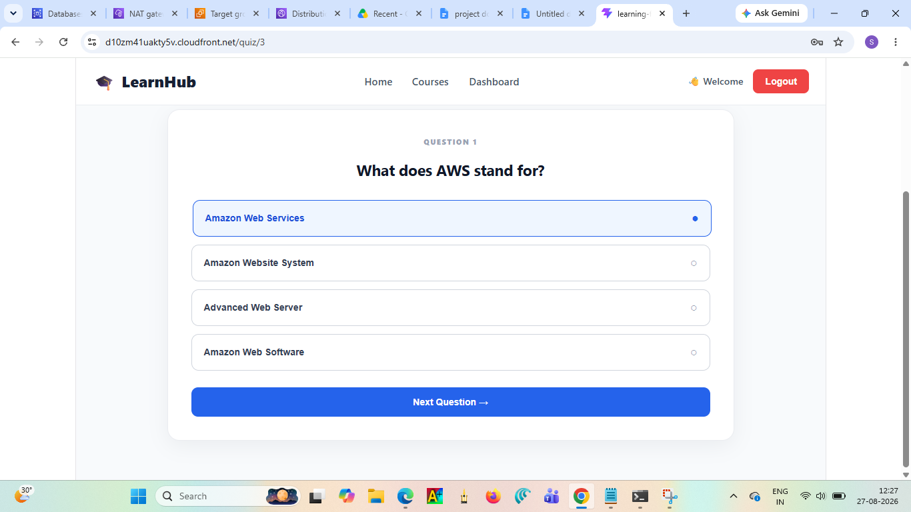
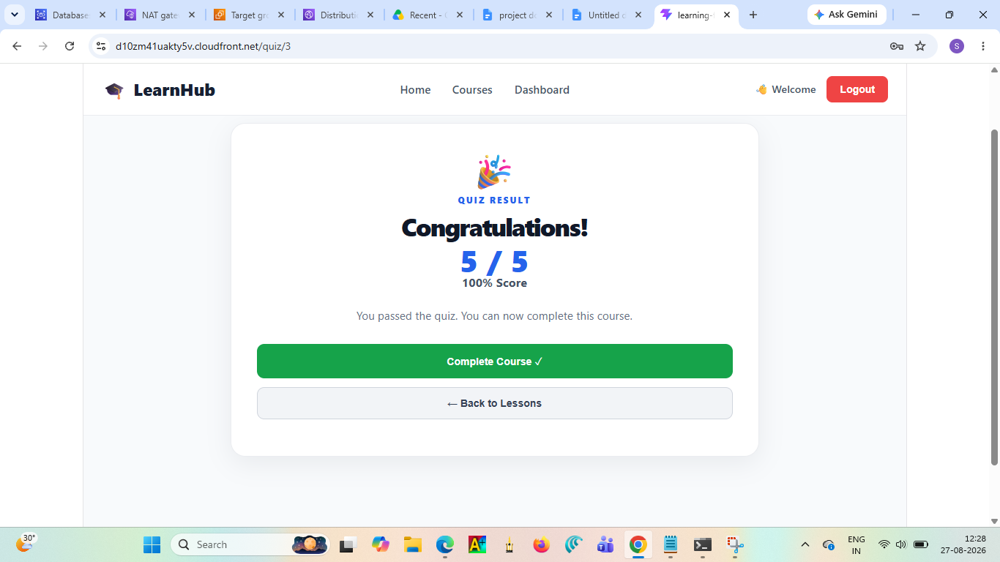

# LearnHub – AWS-Based Online Learning Platform

## 1. Project Overview

LearnHub is a cloud-based online learning platform designed and deployed using AWS services. It provides users with the ability to register, log in, browse courses, access learning materials, and participate in online quizzes.

The application uses a React.js frontend, Node.js backend, and MySQL database. AWS services are integrated to manage application hosting, networking, traffic distribution, storage, content delivery, monitoring, and notifications.

## 2. Problem Statement

Traditional online learning applications hosted on a single server may face several infrastructure challenges as the number of users increases.

The major challenges include:
- **Performance Issues:** A single server may struggle to handle multiple simultaneous user requests.
- **Limited Scalability:** Increasing application resources manually becomes difficult when user traffic grows.
- **Single Point of Failure:** Server failures can make the entire application unavailable.
- **Database Security:** Exposing database resources to the public internet creates security risks.
- **Traffic Management:** Handling incoming requests efficiently becomes challenging during high traffic.
- **Infrastructure Monitoring:** Identifying server failures and resource utilization issues requires continuous monitoring.

## 3. Proposed System

LearnHub addresses these challenges using AWS cloud infrastructure, including load balancing, Auto Scaling, private networking, managed database services, content delivery, and infrastructure monitoring.

## 4. Architecture Diagram

LearnHub follows a three-tier AWS architecture consisting of the presentation, application, and database tiers.

**Tier 1 — Presentation Layer**

The Presentation Layer is responsible for hosting and delivering the frontend content to users. Amazon S3 is used to store the static frontend files, while Amazon CloudFront acts as a Content Delivery Network (CDN) to distribute the content with low latency. CloudFront is configured with two origins: Amazon S3 for frontend content and the Application Load Balancer (ALB) for API requests. Origin Access Control (OAC) is used to secure access to the private S3 bucket and ensure that frontend content is accessed through CloudFront.

**Tier 2 — Application Layer**

The Application Layer handles application processing, backend hosting, and traffic management within an Amazon VPC. The VPC contains public and private subnets to separate internet-facing resources from backend infrastructure. Public subnets host the internet-facing Application Load Balancer, NAT Gateway, and Jump Host (if configured), while private application subnets host the backend EC2 instances. An Internet Gateway enables internet connectivity for public subnet resources, and the NAT Gateway allows private EC2 instances to access the internet for outbound communication. The Application Load Balancer distributes incoming application requests across registered EC2 instances through a Target Group, which performs health checks to monitor instance availability. An Auto Scaling Group automatically adjusts the number of EC2 instances based on application demand, helping maintain availability and performance.

**Tier 3 — Database Layer**

The Database Layer is responsible for securely storing and managing application data. Amazon RDS for MySQL is used as the managed relational database service for storing user information, course details, and other application data. The database is deployed in private database subnets to prevent direct public internet access. An RDS DB Subnet Group defines the subnets available for database deployment, while Security Groups restrict database access to authorized application resources, such as the backend EC2 instances. Multi-AZ deployment, when enabled, provides a standby database instance in another Availability Zone to support high availability and automatic failover.

## AWS Services Used

| AWS Service | Purpose |
|---|---|
| **Amazon EC2** | Hosts the Node.js backend application |
| **Amazon S3** | Stores React frontend static files |
| **Amazon CloudFront** | Delivers frontend content and routes API requests |
| **Application Load Balancer (ALB)** | Distributes API requests across healthy EC2 instances |
| **Auto Scaling Group (ASG)** | Manages backend EC2 instance capacity |
| **Amazon RDS for MySQL** | Stores application data |
| **Amazon VPC** | Provides an isolated network environment |
| **Internet Gateway (IGW)** | Enables internet connectivity for public subnet resources |
| **NAT Gateway** | Enables outbound internet connectivity from private subnets |
| **Amazon CloudWatch** | Monitors infrastructure metrics and configured alarms |
| **Amazon SNS** | Sends email notifications |
| **AWS CloudTrail** | Records AWS account API activity |

## Major Problems Faced During Implementation

**1. Accessing Private EC2 Instances Using a Jump Host**

**Problem**

The backend application instances were deployed inside private subnets and did not have direct public access. Therefore, direct SSH access from the local machine was not available.

**Troubleshooting and Resolution**

A public EC2 instance was configured as a Jump Host (Bastion Host) to provide controlled administrative access to private EC2 instances.

**Access Flow:**

Local Machine
      |
      v
Public EC2 Instance
   (Jump Host)
      |
      v
Private EC2 Instance

The private EC2 instance was accessed through the Jump Host using its private IP address.

This approach allowed administrative access without exposing the backend instances directly to the internet.

Key Finding

A Jump Host provides a controlled access point for managing resources deployed inside private subnets.

**2. Application Load Balancer Target Health Check Failure**

**Problem**

The EC2 instances launched through Auto Scaling were successfully registered with the Application Load Balancer Target Group. However, the targets were initially marked as:

Unhealthy
Health check failed

**Troubleshooting**

The following configurations were reviewed:

Target Group health check configuration

Health check path

Application listening port

Backend application availability

Security Group communication between the ALB and EC2 instances

**Resolution**

The health check and application connectivity configurations were reviewed and corrected until the targets became healthy.

**Key Finding**

An EC2 instance being in the Running state does not guarantee that it is healthy from the Application Load Balancer perspective.

The application must respond successfully to the configured health check.

**3. RDS Instance Capacity Issue**

**Problem**

The Amazon RDS database instance remained in the Starting state and did not become available.

The following error was identified:

Insufficient instance capacity for instance type db.t4g.micro

**Troubleshooting**

The RDS instance status and event history were reviewed through the AWS Management Console.

The issue was identified as insufficient capacity for the selected DB instance type in the selected Availability Zone.

**Resolution**

The RDS capacity issue was investigated by reviewing the instance status and AWS events.

**Key Finding**

Availability of an RDS instance type can vary depending on temporary capacity availability within a specific Availability Zone.

**4. Backend Database Connection Failures**

**Problem**

The backend application encountered database connection failures, which affected API functionality.

The application logs contained errors such as:

Access denied
ECONNREFUSED
ETIMEDOUT
PROTOCOL_CONNECTION_LOST

**Troubleshooting**

The following components were verified:

RDS instance status

Database connectivity from EC2

RDS endpoint configuration

Backend database configuration

Application logs

The database connection was also tested directly from the EC2 instance to verify network connectivity and database authentication.

**Resolution**

After verifying database availability and backend connectivity, the application was able to establish a successful connection to Amazon RDS.

**Key Finding**

Database connectivity depends on multiple configurations, including database availability, endpoint configuration, network access, Security Groups, and authentication credentials.

**5. Inconsistent API Responses Across Multiple EC2 Instances**

**Problem**

Multiple EC2 instances were registered with the Application Load Balancer Target Group and showed healthy status.

However, the backend API response was inconsistent between instances.

One instance returned the expected response, while another instance returned an application error.

**Troubleshooting**

The affected API was tested individually on each EC2 instance:

curl http://localhost:5000/api/progress/3

Backend application logs and database connectivity were also checked on each instance.

**Key Finding**

A healthy Target Group status confirms that the load balancer can successfully reach the target for its configured health check.

However, it does not guarantee that every backend API endpoint or database operation is functioning correctly.

**Resolution**

The backend application logs and database connectivity were investigated to identify inconsistencies between the EC2 instances.

**6. CloudFront Backend API Routing Issue**

**Problem**

CloudFront was initially configured with Amazon S3 as the only origin.

The frontend application loaded successfully, but backend API requests could not reach the backend application.

Cause

The frontend was hosted in Amazon S3, while the backend application was running on EC2 instances behind an Application Load Balancer.

Separate origins and routing behaviors were required for frontend and API requests.

**Resolution**

A second CloudFront origin was configured for the Application Load Balancer.

**CloudFront Origin Configuration:**

Origin 1 → Amazon S3
Origin 2 → Application Load Balancer

A CloudFront cache behavior was configured to route API requests:

/api/* → Application Load Balancer

Final Request Flow:

Frontend Request:

User
 |
 v
CloudFront
 |
 v
Amazon S3
 |
 v
Frontend Application

API Request:

User
 |
 v
CloudFront
 |
 v
Application Load Balancer
 |
 v
EC2 Backend Instances
 |
 v
Amazon RDS

This configuration allowed CloudFront to distribute frontend content through S3 and forward backend API requests to the Application Load Balancer.

**Key Finding**

CloudFront supports multiple origins and cache behaviors, allowing frontend and backend requests to be routed to different AWS resources.

**7. CloudFront Cache Issue**

**Problem**

After updating frontend files in the S3 bucket, the latest changes were not immediately visible through the CloudFront distribution.

**Cause**

CloudFront continued serving previously cached versions of the frontend files.

**Resolution**

A CloudFront invalidation was created using the following path:

/*

After the invalidation was completed, CloudFront fetched the updated content from the origin and delivered the latest frontend version.

**Key Finding**

CloudFront caching improves content delivery performance, but cached objects may need invalidation when updated content must become available immediately.

**8. CloudFront Custom Error Response Configuration**

**Problem**

The frontend application used client-side routes such as:

/courses
/dashboard

When these URLs were accessed directly or refreshed, Amazon S3 could not find corresponding physical files and returned an error.

**Cause**

React client-side routing handles application routes in the browser. However, direct requests to those routes may reach the S3 origin, which does not automatically serve the React entry point for every application route.

**Resolution**

CloudFront Custom Error Responses were configured to return the frontend entry point (/index.html) for the relevant error responses.

403 Error Handling:

403 Error
    |
    v
/index.html
    |
    v
React Application

404 Error Handling:

404 Error
    |
    v
/index.html
    |
    v
React Application

The React application could then handle client-side routing.

**Key Finding**

CloudFront Custom Error Responses can help support client-side routing for single-page applications hosted on Amazon S3.

**9. CloudWatch Alarm and SNS Notification Issue**

**Problem**

A CloudWatch alarm entered the ALARM state, but the expected email notification was not initially received.

**Troubleshooting**

The following configurations were verified:

CloudWatch alarm configuration

SNS Topic configuration

SNS email subscription

Email subscription confirmation status

**Resolution**

The SNS notification configuration and subscription status were reviewed to ensure that alarm notifications could be delivered successfully.

**Key Finding**

CloudWatch alarms can use Amazon SNS to send notifications when monitored metrics meet configured alarm conditions.

An email subscription must be confirmed before SNS can deliver notifications to that email address.

