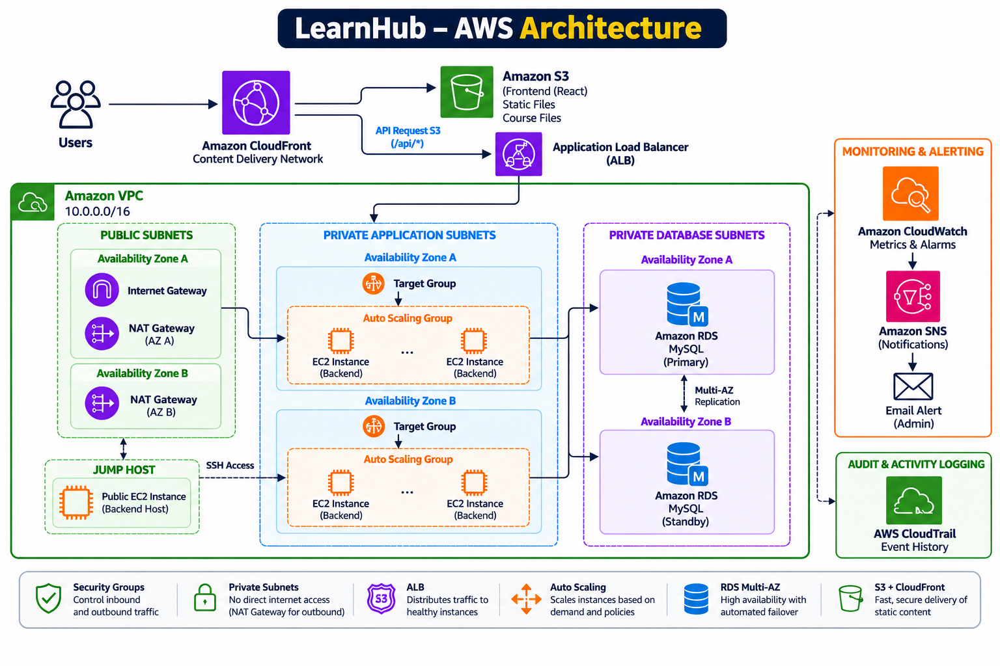

# LearnHub – AWS-Based Online Learning Platform

## 1. Project Overview

LearnHub is a cloud-based online learning platform designed and deployed using AWS services. It provides users with the ability to register, log in, browse courses, access learning materials, and participate in online quizzes.

The application uses a React.js frontend, Node.js backend, and MySQL database. AWS services are integrated to manage application hosting, networking, traffic distribution, storage, content delivery, monitoring, and notifications.

## 2. Problem Statement

Online learning applications may experience varying levels of user traffic. Hosting the entire application on a single server can lead to:

- Performance issues during high traffic.
- Limited application scalability.
- Single points of failure.
- Difficulty managing application resources.
- Challenges in monitoring infrastructure health.

The project focuses on addressing these infrastructure requirements through AWS cloud services.

## 3. Proposed System

LearnHub uses a three-tier cloud architecture to separate the frontend, backend, and database layers.

- **Frontend:** React application and static files are hosted in Amazon S3 and delivered through Amazon CloudFront.
- **Backend:** Node.js application runs on EC2 instances in private subnets.
- **Traffic Distribution:** Application Load Balancer distributes incoming API requests to healthy backend instances.
- **Database:** Amazon RDS MySQL stores application data.
- **Monitoring:** Amazon CloudWatch monitors infrastructure metrics, while Amazon SNS sends email notifications for configured alarms.

## 4. Project Objectives

- Develop a cloud-based online learning platform.
- Deploy frontend and backend application components.
- Configure public and private subnets within an AWS VPC.
- Distribute backend traffic using an Application Load Balancer.
- Manage EC2 instances using an Auto Scaling Group.
- Store application data using Amazon RDS MySQL.
- Deliver frontend content through Amazon CloudFront.
- Monitor infrastructure using Amazon CloudWatch.
- Configure email notifications using Amazon SNS.

## 5. Technologies Used

 Amazon RDS                
| Component      | Technology                      |
| -------------- | ------------------------------- |
| Frontend       | React.js, HTML, CSS, JavaScript |
| Backend        | Node.js, Express.js             |
| Database       | MySQL                           |
| Cloud Platform | Amazon Web Services (AWS)       |

## 6. AWS Services Used             
 Amazon EC2                                  
 Amazon S3                     
Amazon CloudFront                                 
 Application Load Balancer
 Target Group              
Auto Scaling Group                
Amazon VPC                
 Internet Gateway                
 NAT Gateway               
 Amazon CloudWatch        
 Amazon SNS                

## 7. Project Features

- User Registration and Login
- Course Browsing
- Course Details
- Learning Materials
- User Dashboard
- Online Quizzes
- Cloud-based application deployment
- Load balancing and automatic scaling
- Infrastructure monitoring and email alerts

## 8. AWS Architecture

LearnHub follows a three-tier AWS architecture consisting of the presentation, application, and database tiers.



### Architecture Diagram Explanation

**Presentation Tier**

- React frontend hosted on Amazon S3.
- Amazon CloudFront delivers frontend and static content.
- CloudFront uses separate origins for Amazon S3 and the Application Load Balancer.

**Application Tier**

- Node.js backend runs on Amazon EC2 instances.
- Backend instances are deployed in private application subnets.
- Application Load Balancer distributes incoming API requests.
- Auto Scaling Group manages EC2 instance capacity.
- Target Group health checks identify healthy backend instances.

**Database Tier**

- Amazon RDS MySQL stores application data.
- RDS is deployed in private database subnets.
- Backend EC2 instances communicate with the database.

## 9. VPC and Network Architecture

A custom Amazon VPC provides an isolated network environment.

The network architecture includes:

- Public subnets
- Private application subnets
- Private database subnets
- Internet Gateway
- NAT Gateway
- Application Load Balancer
- Jump Host

**Public Layer:** Contains internet-facing infrastructure components such as the Application Load Balancer, NAT Gateway, and Jump Host.

**Private Application Layer:** Hosts backend EC2 instances. Application traffic reaches these instances through the Application Load Balancer.

**Private Database Layer:** Hosts the Amazon RDS MySQL database, which is accessed by the backend application.

## 10. Application Request Flow

**Frontend Request**

User → CloudFront → Amazon S3 → React Frontend

**Backend API Request**

User → CloudFront → /api/\* → Application Load Balancer → Target Group → EC2 Backend → Amazon RDS MySQL

CloudFront is configured with:

- Default Behavior → Amazon S3
- /api/\* → Application Load Balancer

This allows one CloudFront distribution to handle frontend content and backend API requests.

## 11. Monitoring and Notifications

**Amazon CloudWatch**

- Monitors EC2 CPU utilization and infrastructure metrics.
- Uses configured alarms to detect specified conditions.

**Amazon SNS**

- Receives notifications from CloudWatch alarms.
- Sends email alerts when configured alarms change state.

## 12. Security Architecture

The infrastructure follows a layered security approach:

- Backend EC2 instances are deployed in private subnets.
- RDS is deployed in private database subnets.
- Security Groups control communication between infrastructure components.
- Backend traffic is received through the Application Load Balancer.
- NAT Gateway provides outbound connectivity for private instances when required.
- Administrative access to private EC2 instances is provided through a Jump Host.

## 13. High Availability and Scalability

The architecture uses the following AWS components to support availability and scalability:

- Multiple EC2 backend instances.
- Application Load Balancer.
- Target Group health checks.
- Auto Scaling Group.
- Multiple Availability Zones.

The Load Balancer distributes requests across healthy instances, while Auto Scaling manages backend application capacity.

## 14. Project Structure

```text
LearnHub/
├── learning-frontend/
└── learning-backend/
```

## 15. Project Outcome

The project demonstrates the integration of AWS services to deploy and manage a cloud-based online learning application.

Key implementation areas include frontend hosting, backend application deployment, traffic distribution, database management, VPC networking, infrastructure monitoring, and email notifications.

## 16. Future Improvements

- HTTPS configuration with a custom domain.
- AWS WAF integration.
- CI/CD pipeline implementation.
- Infrastructure automation using Terraform or AWS CloudFormation.
- Enhanced application monitoring.
- Database backup and disaster recovery improvements.
- Container-based deployment using Amazon ECS.

## 17. Author

**Sowmiya Muthusamy**

BE – Electronics and Communication Engineering

GitHub: [Sowmiya Muthusamy](https://github.com/sowmiyamuthusamy2829-bot)
